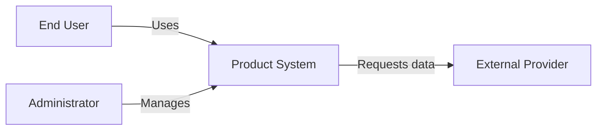
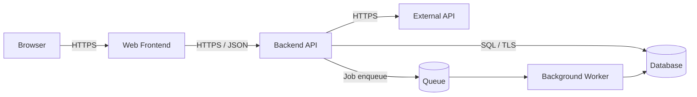
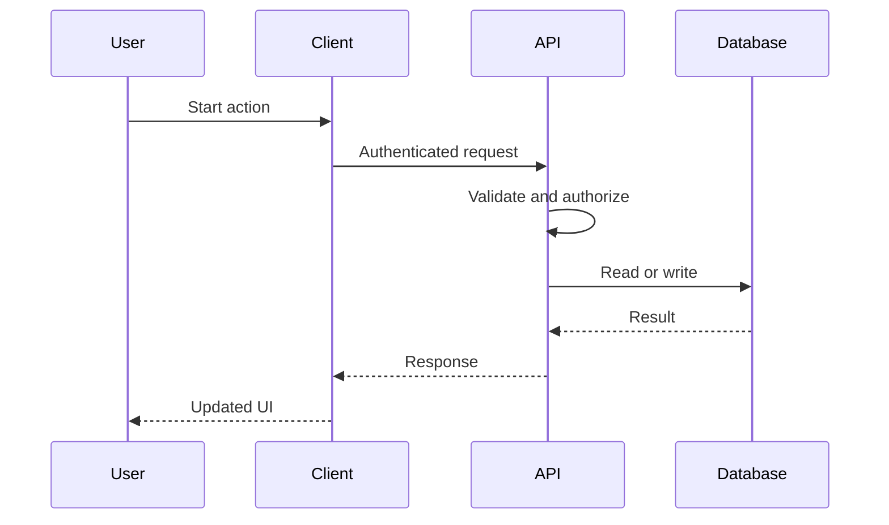
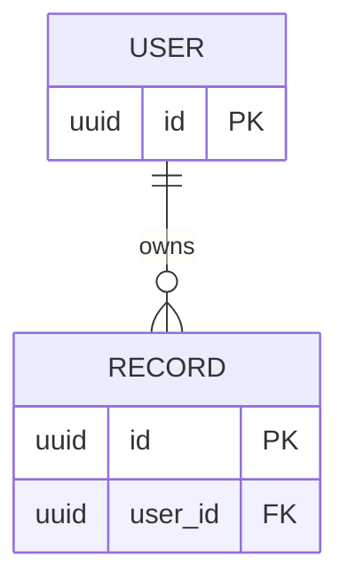
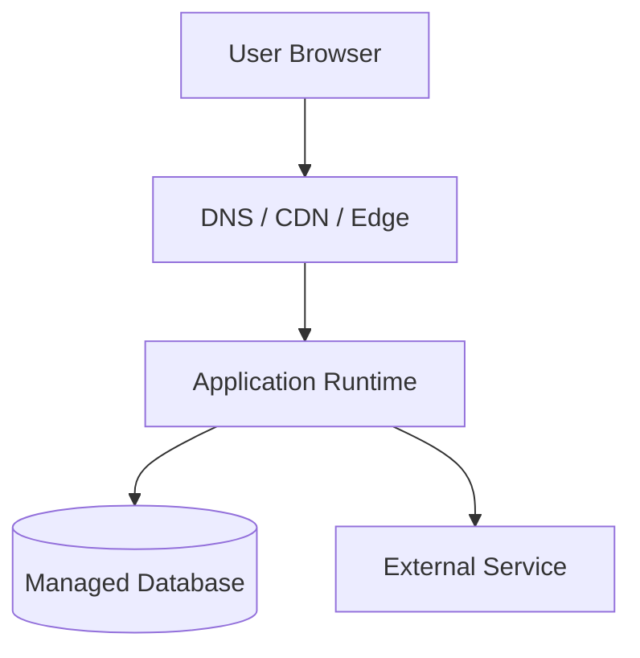

# ARCHITECTURE.md — [PROJECT NAME]

> **Purpose:** Source of truth for how this system is structured, how its parts communicate, and why architectural choices were made. This is a reusable template: replace `[PLACEHOLDERS]`, remove inapplicable sections, and never represent examples as implemented functionality.

| Field | Value |
|---|---|
| Status | [Draft / Reviewed / Approved] |
| Owner | [NAME / TEAM] |
| Last updated | [YYYY-MM-DD] |
| Architecture version | [VERSION] |
| Repository | [LINK] |
| Related documents | `PRD.md`, `MVP.md`, `DESIGN.md`, `AGENTS.md` |

## 1. Executive Summary

### 1.1 System purpose
[Describe the product in 2–4 sentences, primary users, and the key business capability it enables. Link to the PRD rather than duplicating all requirements.]

### 1.2 Architecture at a glance
- **Architecture style:** [Modular monolith / layered / microservices / serverless / event-driven / hybrid]
- **Client applications:** [Web / mobile / desktop / external clients]
- **Primary services:** [LIST]
- **Primary datastore:** [LIST]
- **Infrastructure / hosting:** [LIST]
- **External dependencies:** [LIST]
- **Critical user flows:** [TOP 3–5]
- **Top quality goals:** [Security / latency / reliability / maintainability / cost; prioritize]

### 1.3 Current vs proposed state
| Area | Current (verified) | Proposed | Evidence / owner |
|---|---|---|---|
| Client | [VALUE] | [VALUE] | [LINK] |
| API | [VALUE] | [VALUE] | [LINK] |
| Data | [VALUE] | [VALUE] | [LINK] |
| Deployment | [VALUE] | [VALUE] | [LINK] |

## 2. Goals, Quality Attributes, and Constraints

### 2.1 Architectural goals
1. [GOAL] — supports [PRD REQUIREMENT ID].
2. [GOAL] — supports [PRD REQUIREMENT ID].
3. [GOAL] — supports [PRD REQUIREMENT ID].

### 2.2 Non-goals
- [Explicitly excluded technical capability or scaling scenario.]

### 2.3 Quality attribute scenarios
Use measurable scenarios instead of vague statements like “fast” or “scalable.”

| ID | Attribute | Trigger / conditions | Expected measurable response | Validation |
|---|---|---|---|---|
| QA-001 | Performance | [e.g., read endpoint at target concurrency] | [p95 <= X ms] | [LOAD TEST] |
| QA-002 | Availability | [service instance fails] | [RECOVERY / UPTIME TARGET] | [FAILURE TEST] |
| QA-003 | Security | [unauthorized request] | [DENIED, AUDITED] | [SECURITY TEST] |
| QA-004 | Recoverability | [data loss event] | [RPO X, RTO Y] | [RESTORE DRILL] |
| QA-005 | Cost | [expected monthly traffic] | [BUDGET CAP] | [COST ESTIMATE] |

### 2.4 Constraints and assumptions
- **Budget:** [LIMIT]
- **Team size / skills:** [CONSTRAINTS]
- **Timeline:** [MILESTONES]
- **Required platforms / vendors:** [LIST]
- **Regulatory / data residency:** [LIST OR N/A]
- **Assumptions requiring validation:** [LIST + OWNER]

## 3. System Context (C4 Level 1)

### 3.1 Context diagram
Replace this illustrative Mermaid diagram with actual systems and relationships.



### 3.2 Actors and external systems
| Actor / system | Responsibility | Data exchanged | Trust boundary | Owner |
|---|---|---|---|---|
| [USER] | [ROLE] | [DATA] | [BOUNDARY] | [OWNER] |
| [THIRD PARTY] | [PURPOSE] | [DATA] | [BOUNDARY] | [OWNER] |

### 3.3 Boundaries
- **Inside our system:** [OWNED COMPONENTS]
- **Outside our system:** [THIRD-PARTY SERVICES]
- **Trust boundaries:** [BROWSER → API, API → DATABASE, API → THIRD PARTY]
- **Sensitive data crossing boundaries:** [TYPES, ENCRYPTION, AUTHORIZATION]

## 4. Container Architecture (C4 Level 2)

### 4.1 Container diagram
Example only; adapt or remove containers as appropriate. In C4, a *container* is a separately runnable/deployable application or datastore, not necessarily a Docker container.



### 4.2 Container inventory
| Container | Responsibility | Technology | Deployment unit | Scaling approach | Owner |
|---|---|---|---|---|---|
| [Frontend] | [UI / presentation] | [STACK] | [UNIT] | [STRATEGY] | [OWNER] |
| [API] | [Domain operations] | [STACK] | [UNIT] | [STRATEGY] | [OWNER] |
| [Database] | [Persistence] | [STACK] | [UNIT] | [STRATEGY] | [OWNER] |
| [Worker] | [Async processing] | [STACK] | [UNIT] | [STRATEGY] | [OWNER] |

### 4.3 Key communication paths
| Source → destination | Protocol | Auth | Data format | Timeout | Retries / idempotency |
|---|---|---|---|---|---|
| [CLIENT → API] | [HTTPS] | [SESSION / TOKEN] | [JSON] | [X s] | [RULE] |
| [API → DB] | [SQL/TLS] | [SERVICE CREDENTIALS] | [ROWS] | [X s] | [RULE] |

## 5. Component Design (C4 Level 3)

### 5.1 Module boundaries
Document the components of each important container; skip unnecessary class-level detail.

| Component | Responsibility | Public interface | Dependencies | Owns data? | Source path |
|---|---|---|---|---|---|
| [Authentication] | [PURPOSE] | [FUNCTIONS / ROUTES] | [LIST] | [YES/NO] | [PATH] |
| [Domain service] | [PURPOSE] | [FUNCTIONS / ROUTES] | [LIST] | [YES/NO] | [PATH] |
| [Repository] | [PURPOSE] | [METHODS] | [LIST] | [YES/NO] | [PATH] |

### 5.2 Dependency rules
- **Allowed dependency direction:** [e.g., handlers → services → repositories].
- **Forbidden dependencies:** [e.g., domain logic importing HTTP controllers].
- **Shared code policy:** [WHAT IS SHARED AND WHY].
- **Module ownership:** [WHICH MODULE OWNS EACH BUSINESS RULE].

### 5.3 Repository layout
```text
[repo]/
├── [frontend]/         # [PURPOSE]
├── [backend]/          # [PURPOSE]
├── [infra]/            # [PURPOSE]
├── [tests]/            # [PURPOSE]
└── docs/               # [ARCHITECTURE / ADRs]
```

## 6. Runtime Behavior and Data Flows

### 6.1 Critical flow: [NAME]
- **Entry point:** [ROUTE / EVENT]
- **Preconditions:** [AUTH, INPUT, STATE]
- **Success outcome:** [OBSERVABLE RESULT]
- **Failure modes:** [TIMEOUT, INVALID INPUT, DOWNSTREAM FAILURE]
- **Idempotency / consistency:** [GUARANTEES]



### 6.2 Additional flows
Document each important flow with the same fields: [SIGN-IN], [CREATE/UPDATE], [BACKGROUND JOB], [EXTERNAL WEBHOOK], [FAILURE/RETRY].

### 6.3 Async processing
- **Queue / broker:** [TECHNOLOGY OR NONE]
- **Job types:** [LIST]
- **Delivery semantics:** [AT LEAST ONCE / OTHER]
- **Retry/backoff:** [POLICY]
- **Deduplication / idempotency key:** [POLICY]
- **Dead-letter / poison message handling:** [POLICY]
- **Ordering guarantees:** [IF REQUIRED]

## 7. Data Architecture

### 7.1 Data ownership and storage
| Entity / dataset | Source of truth | Storage | Owner | Retention | Sensitivity |
|---|---|---|---|---|---|
| [USER] | [SYSTEM] | [DB/TABLE] | [SERVICE] | [PERIOD] | [LEVEL] |
| [DOMAIN OBJECT] | [SYSTEM] | [DB/TABLE] | [SERVICE] | [PERIOD] | [LEVEL] |

### 7.2 Data model
Include an ERD for core entities; this is illustrative only.



### 7.3 Schema conventions
- **IDs:** [UUID / BIGINT / OTHER]
- **Timestamps and timezones:** [UTC STORAGE / DISPLAY RULE]
- **Constraints and indexes:** [UNIQUE, FK, COMPOSITE INDEX RULES]
- **Soft delete / hard delete:** [POLICY]
- **Migrations:** [TOOL, FORWARD / ROLLBACK PLAN]
- **Transactions:** [BOUNDARIES AND ISOLATION NEEDS]
- **Multi-tenancy:** [TENANT IDENTIFIER, ISOLATION, RLS OR OTHER]
- **Backups and restores:** [FREQUENCY, TESTING, RPO/RTO]
- **PII / secrets:** [DATA CLASSIFICATION AND HANDLING]

### 7.4 Caching and consistency
- **Cache locations:** [CDN / CLIENT / SERVER / REDIS / NONE]
- **Cache keys and TTLs:** [RULES]
- **Invalidation:** [TRIGGERS]
- **Consistency model:** [STRONG / EVENTUAL / MIXED]
- **Conflict handling:** [RULES]

## 8. APIs and Integration Contracts

### 8.1 API conventions
- **Style:** [REST / GraphQL / RPC / EVENTS]
- **Base path and versioning:** [PATH / STRATEGY]
- **Authentication / authorization:** [SCHEME AND PERMISSION CHECKS]
- **Request validation:** [SCHEMA TOOL]
- **Error format:** [EXAMPLE OR OPENAPI LINK]
- **Pagination / filtering / sorting:** [CONVENTIONS]
- **Rate limiting:** [LIMITS AND RESPONSES]
- **Idempotency:** [WHICH WRITE OPERATIONS]
- **Compatibility / deprecation:** [POLICY]
- **API specification:** [OPENAPI / SCHEMA LINK]

### 8.2 Endpoint inventory
| ID | Method | Path | Purpose | Auth / role | Request | Response | Errors |
|---|---|---|---|---|---|---|---|
| API-001 | [POST] | [/resource] | [ACTION] | [ROLE] | [SCHEMA] | [SCHEMA] | [4XX/5XX] |

### 8.3 External dependencies
| Provider | Purpose | Credentials | Timeout | Quota | Outage behavior | Data shared |
|---|---|---|---|---|---|---|
| [SERVICE] | [USE] | [SECRET REF] | [X] | [LIMIT] | [FALLBACK] | [FIELDS] |

### 8.4 Webhooks / event contracts
- **Signature verification:** [HOW]
- **Replay protection:** [HOW]
- **Event schema / version:** [LINK]
- **Deduplication:** [EVENT ID]
- **Ordering / eventual consistency:** [EXPECTATIONS]

## 9. Authentication, Authorization, and Security

### 9.1 Identity and sessions
- **Identity provider:** [PROVIDER / SELF-HOSTED]
- **Sign-in methods:** [LIST]
- **Session / token storage:** [COOKIE / TOKEN RULES]
- **Expiration / rotation / logout:** [POLICY]
- **MFA:** [REQUIRED / OPTIONAL / N/A]

### 9.2 Authorization matrix
| Resource / action | Anonymous | User | Admin | Enforcement point |
|---|---|---|---|---|
| [READ OWN RECORD] | [NO] | [YES] | [POLICY] | [API / RLS] |
| [DELETE USER] | [NO] | [POLICY] | [POLICY] | [API / RLS] |

### 9.3 Threat model
| Threat / trust boundary | Impact | Mitigation | Verification | Owner |
|---|---|---|---|---|
| [BROKEN ACCESS CONTROL] | [HIGH] | [AUTHZ CHECKS] | [NEGATIVE TESTS] | [OWNER] |
| [SECRET EXPOSURE] | [HIGH] | [SECRET MANAGER] | [SCAN] | [OWNER] |
| [INPUT INJECTION] | [HIGH] | [PARAMETERIZED QUERIES] | [TEST] | [OWNER] |

### 9.4 Security controls
- **Transport and encryption at rest:** [TLS, KMS, ETC.]
- **Secrets management:** [PROVIDER, ROTATION]
- **Input/output protection:** [VALIDATION, ENCODING, CSRF/CORS]
- **Audit logs:** [WHICH EVENTS AND RETENTION]
- **Supply-chain controls:** [DEPENDENCY / IMAGE SCANS]
- **Data minimization / deletion:** [POLICY]
- **Incident response contact:** [OWNER]

## 10. Infrastructure and Deployment (C4 Deployment View)

### 10.1 Environments
| Environment | Purpose | URL / region | Data policy | Deploy trigger | Access |
|---|---|---|---|---|---|
| Local | Development | [LOCAL] | [SYNTHETIC] | [MANUAL] | [DEV] |
| Staging | Validation | [URL] | [NON-PROD] | [CI] | [TEAM] |
| Production | Users | [URL/REGION] | [PROD] | [APPROVED CI] | [RESTRICTED] |

### 10.2 Deployment diagram


### 10.3 Delivery pipeline
- **Source control / branching:** [STRATEGY]
- **CI steps:** [LINT → TYPECHECK → TEST → BUILD → SCAN]
- **Artifact build and registry:** [LOCATION]
- **Infrastructure as code:** [TOOL / PATH]
- **Secrets injection:** [METHOD]
- **Release strategy:** [ROLLING / BLUE-GREEN / CANARY]
- **Rollback:** [EXACT STEPS AND OWNER]
- **Database migration sequencing:** [BACKWARD-COMPATIBILITY RULES]
- **Feature flags:** [TOOL AND CLEANUP POLICY]

### 10.4 Local development
- **Prerequisites:** [VERSIONS / TOOLS]
- **Start commands:** [COMMANDS]
- **Seed / test data:** [COMMANDS]
- **Environment variables:** [NAMES AND PURPOSES; NEVER VALUES]
- **Common failures:** [TROUBLESHOOTING LINK]

## 11. Reliability, Performance, and Scalability

### 11.1 Capacity assumptions
| Metric | Current / expected | Peak / growth | Source / confidence |
|---|---|---|---|
| Monthly active users | [VALUE] | [VALUE] | [SOURCE] |
| Requests per second | [VALUE] | [VALUE] | [SOURCE] |
| Data volume | [VALUE] | [VALUE] | [SOURCE] |
| Background jobs | [VALUE] | [VALUE] | [SOURCE] |

### 11.2 Reliability controls
- **SLO / SLA:** [SERVICE INDICATOR AND TARGET]
- **Health / readiness checks:** [ENDPOINTS]
- **Timeouts and retries:** [BOUNDS, BACKOFF, JITTER]
- **Circuit breaking / load shedding:** [POLICY]
- **Graceful degradation:** [WHAT STILL WORKS]
- **Single points of failure:** [LIST]
- **Disaster recovery:** [RPO/RTO, FAILOVER, RESTORE DRILLS]

### 11.3 Performance plan
- **Critical path latency budgets:** [BROWSER, API, DB, THIRD PARTY]
- **Database indexes / query budgets:** [RULES]
- **Caching / batching / pagination:** [RULES]
- **Load tests:** [TOOL, SCENARIOS, PASS CRITERIA]
- **Scaling triggers:** [CPU, QUEUE DEPTH, LATENCY, ETC.]

## 12. Observability and Operations

### 12.1 Telemetry
- **Structured logs:** [FIELDS, CORRELATION ID, REDACTION]
- **Metrics:** [LATENCY, ERRORS, TRAFFIC, SATURATION, QUEUE DEPTH]
- **Traces:** [REQUEST PROPAGATION]
- **Dashboards:** [LINKS]
- **Retention / access:** [POLICY]

### 12.2 Alerts and runbooks
| Alert | Threshold | Severity | On-call / owner | Runbook |
|---|---|---|---|---|
| [ERROR RATE] | [THRESHOLD / WINDOW] | [SEV] | [OWNER] | [LINK] |
| [DATABASE UNAVAILABLE] | [CONDITION] | [SEV] | [OWNER] | [LINK] |

- **Incident response:** [TRIAGE, ESCALATION, COMMUNICATION]
- **Operational tasks:** [CERT RENEWAL, PATCHES, BACKUP CHECKS]
- **Cost monitoring:** [BUDGET, ALERTS, OWNER]

## 13. Testing and Verification Strategy

| Layer | Scope | Tool / approach | Gate |
|---|---|---|---|
| Unit | [DOMAIN LOGIC] | [TOOL] | [PASS] |
| Integration | [DB, API, QUEUE] | [TOOL] | [PASS] |
| Contract | [API / EVENT SCHEMAS] | [TOOL] | [PASS] |
| End-to-end | [CRITICAL FLOWS] | [TOOL] | [PASS] |
| Security | [AUTHZ / SECRETS / INPUT] | [TOOL] | [PASS] |
| Load / resilience | [TARGETS FROM §2] | [TOOL] | [PASS] |
| Recovery | [RESTORE / ROLLBACK] | [DRILL] | [PASS] |

- **Test fixtures:** [POLICY]
- **External-service mocking:** [RULES]
- **CI required checks:** [LIST]
- **Requirement traceability:** [PRD ID → COMPONENT → TEST]

## 14. Architectural Decisions (ADRs)

Maintain major decisions in `docs/adr/` and link them here. Capture the context, considered alternatives, rationale, consequences, and status—not just the chosen tool.

| ADR | Decision | Status | Date | Link |
|---|---|---|---|---|
| ADR-001 | [MONOLITH VS SERVICES] | [PROPOSED] | [DATE] | [PATH] |

### ADR template
```markdown
# ADR-XXX: [Decision title]
- Date: [YYYY-MM-DD]
- Status: [Proposed / Accepted / Superseded / Deprecated]
- Context: [Problem and constraints]
- Decision drivers: [Criteria]
- Options considered: [Option A, B, C]
- Decision: [Chosen approach]
- Rationale: [Why it best meets goals]
- Positive consequences: [Benefits]
- Negative consequences: [Costs and trade-offs]
- Revisit when: [Trigger / threshold]
- References: [Links]
```

## 15. Risks, Technical Debt, and Evolution

| ID | Risk / debt | Likelihood | Impact | Mitigation | Owner | Review date |
|---|---|---|---|---|---|---|
| R-001 | [RISK] | [L/M/H] | [L/M/H] | [ACTION] | [OWNER] | [DATE] |

### Growth roadmap
- **Current design supports:** [SCALE AND CAPABILITIES]
- **Known bottlenecks:** [LIST]
- **Scale-out triggers:** [MEASURABLE THRESHOLDS]
- **Potential future changes:** [OPTIONS, NOT COMMITMENTS]
- **Migration path:** [HOW TO CHANGE WITHOUT BREAKING CLIENTS]

## 16. Open Questions and Review Checklist

| Question | Decision owner | Deadline | Status |
|---|---|---|---|
| [QUESTION] | [OWNER] | [DATE] | [OPEN] |

### Architecture review checklist
- [ ] Architecture matches PRD requirements and MVP scope.
- [ ] Current and proposed states are clearly distinguished.
- [ ] System context and trust boundaries are documented.
- [ ] Container responsibilities and communication are explicit.
- [ ] Critical flows include error and retry behavior.
- [ ] Data ownership, constraints, migrations, and backups are documented.
- [ ] API contracts and authorization enforcement are clear.
- [ ] Quality attributes have measurable targets.
- [ ] Deployment, rollback, monitoring, and recovery are documented.
- [ ] Key trade-offs have ADRs.
- [ ] Known risks, assumptions, and open questions have owners.
- [ ] Diagrams reflect the actual implementation.

## 17. Instructions for AI Coding Agents

1. Read `PRD.md`, `MVP.md`, `DESIGN.md`, and this document before architecture-changing work.
2. Inspect the repository to verify what actually exists; never treat illustrative diagrams as implemented code.
3. Respect documented module boundaries, API contracts, and data ownership.
4. Before adding a new service, queue, cache, or database, explain why existing components cannot meet the requirement.
5. Do not introduce credentials, secrets, or production data into source control or documentation.
6. For schema or API changes, document migration and backward compatibility.
7. For critical operations, handle timeouts, retries, idempotency, authorization, and observable failures as appropriate.
8. Update diagrams, inventories, and relevant ADRs when architectural changes are accepted.
9. Do not invent SLOs, infrastructure, deployment capabilities, or performance results; mark unknowns explicitly.
10. Report deviations from this document and obtain review for major structural changes.

## 18. Glossary and References

| Term | Definition |
|---|---|
| [TERM] | [DOMAIN-SPECIFIC DEFINITION] |

### Reference frameworks
- C4 Model: https://c4model.com/diagrams
- arc42 architecture documentation: https://docs.arc42.org/
- arc42 template repository: https://github.com/arc42/arc42-template
- AWS Well-Architected Framework: https://docs.aws.amazon.com/wellarchitected/latest/framework/the-pillars-of-the-framework.html
- arc42 ADR guidance: https://docs.arc42.org/section-9/

### Project references
- Product requirements: [`PRD.md`](PRD.md)
- MVP scope: [`MVP.md`](MVP.md)
- Frontend design: [`DESIGN.md`](DESIGN.md)
- Engineering conventions: [`AGENTS.md`](AGENTS.md)
- API schema: [LINK]
- Infrastructure repository: [LINK]

---

## How to use this template
1. Replace placeholders with verified project details; remove irrelevant components and examples.
2. Start with sections 1–4, 6–9, and 14 for a small MVP; expand operations and scaling sections as needed.
3. Prefer system-context, container, deployment, and critical-flow diagrams over exhaustive class diagrams.
4. Link detailed schemas, API specifications, and ADRs rather than copying them into multiple files.
5. Review architecture changes alongside code changes in pull requests.
