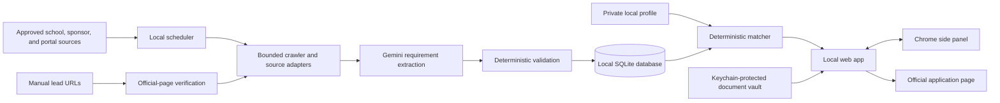

# PathAid

PathAid is a local-first scholarship finder and application copilot for one
student. It discovers scholarships from approved public sources, extracts
requirements with Gemini, evaluates eligibility deterministically against a
private local profile, and helps fill applications in Chrome. The student
reviews every application and submits it personally.

## Quick start on macOS

```bash
git clone https://github.com/aidanjiang/Pathaid.git
cd Pathaid
scripts/pathaid bootstrap
scripts/pathaid set-gemini-key
scripts/pathaid start
```

Open `http://127.0.0.1:3000`. For the application copilot, load `extension/`
from `chrome://extensions` in developer mode, then run:

```bash
scripts/pathaid configure-extension PASTE_THE_EXTENSION_ID
scripts/pathaid stop
scripts/pathaid start
scripts/pathaid copy-extension-token
```

Operational commands are `scripts/pathaid status`, `stop`, `backup`, `restore`,
and `reset`. Backup/restore prompt for a separate archive passphrase; reset
prints its exact targets and requires typing `RESET`.

> **Redesign status:** Phases 1–6 and the automated release gates are
> implemented: the local SQLite/Keychain
> foundation, private profile, strict deterministic matching, accountless UI,
> bounded source registry, generic directory acquisition, and the
> AcademicWorks/Blackbaud and Kaleidoscope public adapters are verified. Manual
> leads can be checked against immutable official sponsor evidence, and source
> scans require an immutable policy review. Validated extractions activate
> immutable scholarship versions without a review queue. A durable daily
> scheduler performs launch-time catch-up and resumes committed stages. Missing
> pages deactivate results without deleting history, returning pages reactivate
> retained records, and deadlines expire in their configured timezone. Save,
> Apply, Skip this cycle, the three-state Saved view, automatically considered
> awards, and verified sweepstakes sections are implemented. The Chrome
> extension foundation now connects an unpacked side panel to the authenticated
> loopback API; generic forms and AcademicWorks/Blackbaud applications preview
> and fill explicitly approved safe fields, including dedicated conservative
> mappings for AcademicWorks/Blackbaud and Kaleidoscope. Reviewed field
> corrections are remembered locally by exact portal and form shape, and Apply
> opens the retained official page with the extension side panel. A Keychain-
> backed encrypted vault now manages one résumé and transcript, with one click
> required per exact attachment target. The local student-written essay bank,
> deterministic metadata recommendations, guarded Gemini mismatch analysis,
> explicit essay-file attachment, encrypted backups, and local settings are
> also implemented. Follow
> [plan.md](plan.md) for authoritative status.

## Product boundaries

- Scholarship discovery is automated only on user-approved sources and within
  strict crawl boundaries.
- Eligibility is deterministic: Gemini extracts public requirements but never
  decides whether the student qualifies.
- BigFuture, Scholarship America, and Bold.org begin as manual lead sources;
  PathAid stores individual URLs and verifies the official sponsor page.
- The Chrome extension previews and fills forms, including sensitive fields,
  but never submits, signs, certifies, bypasses MFA/CAPTCHA, or stores portal
  passwords.
- Résumé, transcript, and essay attachments each require a user click.
- Essays are written by the student. Gemini may recommend an existing essay and
  identify mismatched sections, but it does not write or rewrite essays.
- Automation and AI assistance are disabled when official rules prohibit them.

## Intended workflow

1. Complete one private local profile, including school, residence, academics,
   activities, employment, volunteering, memberships, and optional sensitive
   eligibility information.
2. Confirm official scholarship directories for the current school and approve
   any additional source domains or path prefixes.
3. Let the local scheduler scan due sources when the Mac is running. If a daily
   scan was missed, PathAid catches up on the next launch.
4. Review **Strong match**, **Possible match**, and **Not a match** results.
5. Save, skip for the current cycle, or apply to a scholarship.
6. Click **Apply** to create a minimal tracker entry, open the official
   application, and open the Chrome side panel.
7. Preview proposed form values, fill supported fields, attach selected files,
   review the complete application, and submit it personally.

Saved scholarships display **Not started**, **In progress**, or **Already
applied**. Automatically considered scholarships appear separately and do not
pretend that PathAid submitted an application.

## Target architecture



The target runtime is a local FastAPI service bound to `127.0.0.1`, a local
Next.js interface, SQLite, a bounded discovery worker, and a Manifest V3 Chrome
extension. See [architecture](docs/ARCHITECTURE.md) and [diagrams](docs/ARCHITECTURE_DIAGRAM.md).

## Source policy

The first automatic source set is:

- user-approved official college scholarship directories;
- official scholarship sponsor pages;
- public AcademicWorks/Blackbaud listings;
- public Kaleidoscope listings; and
- bounded same-domain directories explicitly approved by the user.

Every crawl obeys `robots.txt`, rate limits, approved host/path boundaries, a
small depth and page budget, and public-page-only access. PathAid never bypasses
login walls or CAPTCHAs. Aggregators can suggest leads, but a current official
sponsor page must support the match.

## Privacy and AI

The profile, matching, saved status, essays, and document metadata remain local.
Gemini receives public scholarship content for extraction. Sensitive profile
fields are not sent to Gemini for eligibility. Full essay analysis is optional
and must be disabled when scholarship rules prohibit AI assistance; users must
also understand the data handling terms of their Gemini account tier.

Résumé and transcript copies are encrypted with a key protected by macOS
Keychain. Backups may include profile, scholarships, essay bank, source
approvals, mappings, and application status, but exclude document contents,
API keys, encryption keys, and credentials.

## Repository map

```text
backend/       Local FastAPI foundation plus retained domain modules
frontend/      Accountless local Next.js profile and discovery interface
extension/     Manifest V3 application copilot and safe form adapters
docs/          Product, architecture, UX, and setup specifications
features/      Ordered feature contracts and acceptance criteria
plan.md        Redesign implementation plan and status
```

## Documentation

- [Product requirements](docs/PRD.md)
- [MVP definition](docs/MVP.md)
- [Architecture](docs/ARCHITECTURE.md)
- [Architecture diagrams](docs/ARCHITECTURE_DIAGRAM.md)
- [Local setup and operations](INSTRUCTIONS.md)
- [Optional live release smoke tests](docs/LIVE_SMOKE_TESTS.md)
- [Feature index](features/README.md)
- [Implementation plan](plan.md)
