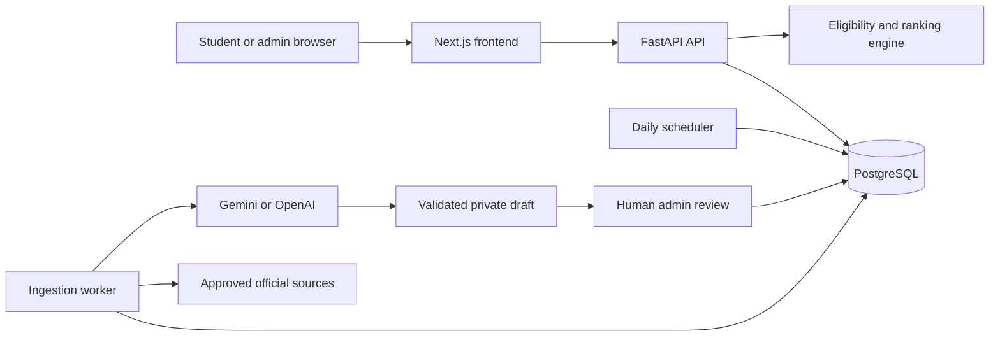

# PathAid

PathAid is a source-backed scholarship and student-support discovery platform.
Students create a reusable profile, receive deterministic eligibility guidance,
and inspect reviewed requirements, evidence, deadlines, checklists, and official
application links.

PathAid also automates scholarship discovery. A scheduler checks approved
official sources, workers acquire changed content, and Gemini proposes structured
catalog drafts. Deterministic validation and human review are required before
anything becomes public. AI never decides student eligibility or publishes a
scholarship by itself.

> **Project status:** The local MVP application, automated ingestion pipeline,
> admin review workflow, and test foundation are implemented. Human launch-catalog
> review and hosted production verification remain release gates.

## Highlights

- Student signup, login, logout, profile editing, and account deletion
- Optional race, ethnicity, first-generation, Pell, academic, and aid fields
- Three-valued eligibility logic: true, false, or unknown
- Stable ranking across eligibility, availability, deadlines, and relevance
- Source-backed opportunity details and application checklists
- Daily approved-source scans with content-change detection
- Durable ingestion jobs with leases, retries, and persisted progress
- Gemini or OpenAI extraction behind configurable provider adapters
- Private draft editing, validation, approval, rejection, and audit history
- Separate student and administrator sessions with HttpOnly cookies and CSRF
- Responsive Next.js student and administrator interfaces

## Architecture



The HTTP API, scheduler, and worker run as separate processes. PostgreSQL is the
system of record and coordinates background work, so queued jobs and progress
survive process or container restarts.

The ingestion boundary is intentionally conservative:

```text
approved source → acquire → detect change → extract → validate → private draft
                                                            → human publication
```

The student path remains deterministic:

```text
saved profile + reviewed published rules → eligibility engine → ranked results
```

See the full [architecture diagrams](docs/ARCHITECTURE_DIAGRAM.md) and
[architecture specification](docs/ARCHITECTURE.md).

## Technology

| Layer | Technology |
| --- | --- |
| Web | Next.js 16, React 19, TypeScript |
| API | FastAPI, Python 3.14, Pydantic |
| Persistence | PostgreSQL 16, SQLAlchemy, Alembic |
| Automation | Python scheduler and leased worker processes |
| AI adapters | Google Gemini or OpenAI |
| Testing | Pytest, Playwright, axe-core |
| Infrastructure | Docker Compose, Caddy, GitHub Actions |

## Quick start with Docker

### Prerequisites

- Docker Desktop with Docker Compose v2
- Git
- An optional Gemini or OpenAI API key for live extraction and AI-assisted
  explanations; matching and template explanations do not require a key

### Start the application

1. Create your uncommitted environment file:

   ```bash
   cp .env.example .env
   ```

2. Set the required values in `.env`:

   ```dotenv
   POSTGRES_DB=pathaid
   POSTGRES_USER=pathaid
   POSTGRES_PASSWORD=choose-a-long-random-local-password
   PATHAID_ADMIN_EMAIL=admin@example.com
   PATHAID_ADMIN_PASSWORD_HASH='scrypt$...'
   PATHAID_PUBLIC_ORIGIN=http://localhost:3000
   PATHAID_SECURE_COOKIES=false
   ```

   The [setup guide](INSTRUCTIONS.md#administrator-password-setup-or-reset)
   explains how to generate the administrator password hash. Store the entire
   hash, including the `scrypt$` prefix. Never place the plain password in
   `.env`.

3. Optionally configure Gemini:

   ```dotenv
   GEMINI_API_KEY=your-key
   PATHAID_EXTRACTION_PROVIDER=gemini
   PATHAID_RECOMMENDATION_PROVIDER=gemini
   ```

4. Build and start the stack:

   ```bash
   docker compose up --build --detach
   docker compose ps
   ```

Docker Compose starts PostgreSQL, applies Alembic migrations, and then starts
the FastAPI API, worker, scheduler, and Next.js frontend.

### Local URLs

- Student application: <http://localhost:3000>
- Administrator login: <http://localhost:3000/admin/login>
- API liveness: <http://localhost:8000/health/live>
- API readiness: <http://localhost:8000/health/ready>

`live` means the API process is running. `ready` additionally confirms that the
database is reachable and its migrations are current.

## Student workflow

1. Create an account and complete the core profile.
2. Add any optional eligibility details in **Student profile**.
3. Open **Discover** to view deterministically ranked opportunities.
4. Inspect requirement-level reasons, retained evidence, and application
   materials.
5. Continue to the official provider website to apply.

Unknown profile information stays unknown; PathAid does not convert missing
answers into a pass or failure and does not predict whether a student will win
an award.

## Ingestion and review workflow

1. The scheduler finds an approved source that is due for a scan.
2. A worker claims the durable job with a temporary lease.
3. The worker safely acquires the official page and compares its content hash.
4. Changed content is sent to the configured extraction provider.
5. Deterministic validators check schemas, rules, evidence, URLs, and dates.
6. The result becomes a private draft.
7. An administrator compares the proposal with the retained source, corrects
   it when needed, and approves or rejects it.
8. Approval atomically publishes an immutable revision.

Workers can retry bounded transient failures. A failed extraction or expired
worker lease cannot replace a currently published revision.

## Development

For native development, keep the Python virtual environment inside `backend/`.

```bash
cd backend
python3 -m venv .venv
source .venv/bin/activate
python -m pip install -r requirements-dev.txt
export DATABASE_URL=sqlite:///./pathaid.db
alembic upgrade head
uvicorn app.main:app --reload
```

In a second terminal:

```bash
cd frontend
npm install
npm run dev
```

Docker may already be using ports 3000 and 8000. Stop the corresponding
containers before starting native servers.

## Tests

Backend:

```bash
cd backend
.venv/bin/pytest -q
.venv/bin/python -m app.quality_report
```

Frontend:

```bash
cd frontend
npm run lint
npm run build
npx playwright install chromium
npm run test:e2e
```

The browser suite includes responsive workflow and accessibility checks.
External AI calls are not required for the normal test suite.

## Useful Docker commands

```bash
docker compose ps                    # Show service status
docker compose logs --follow api     # Follow API logs
docker compose logs --follow worker  # Follow ingestion logs
docker compose restart api           # Restart one service
docker compose up --build --detach   # Rebuild and start changed services
docker compose down                  # Stop services and preserve database data
```

Do not add `--volumes` to `docker compose down` unless you intentionally want
to delete the local PostgreSQL data.

## Repository structure

```text
backend/
  app/          FastAPI routes, domain logic, scheduler, and worker
  migrations/   Ordered Alembic database migrations
  tests/        API, domain, orchestration, and security tests
frontend/
  src/app/      Next.js student and administrator routes
  src/components/
  tests/e2e/    Playwright workflow and accessibility tests
docs/           Product, architecture, deployment, and operating documentation
features/       Feature-level behavior and acceptance criteria
compose.yaml    Local multi-container environment
plan.md         Delivery plan and implementation status
```

## Documentation

- [Setup and command guide](INSTRUCTIONS.md)
- [Product requirements](docs/PRD.md)
- [MVP definition](docs/MVP.md)
- [Architecture](docs/ARCHITECTURE.md)
- [Architecture diagrams](docs/ARCHITECTURE_DIAGRAM.md)
- [Deployment guide](docs/deployment.md)
- [Feature specifications](features/README.md)

## Security and responsible AI

- Passwords are stored as salted hashes, never as plaintext.
- Student and admin sessions use separate opaque HttpOnly cookies.
- CSRF tokens protect authenticated mutations.
- Profile fields are allowlisted and validated; sensitive values are excluded
  from operational telemetry.
- Source acquisition is bounded to administrator-approved scopes.
- AI output is treated as an untrusted proposal and must pass deterministic
  validation and human review.
- Eligibility labels and ranking are produced by deterministic code, not an
  LLM.

Do not commit `.env`, API keys, session cookies, database dumps, or exported
catalog bundles containing retained source text.
