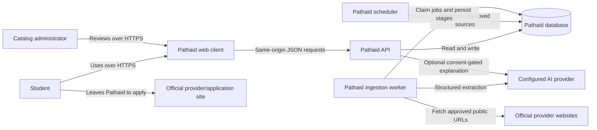
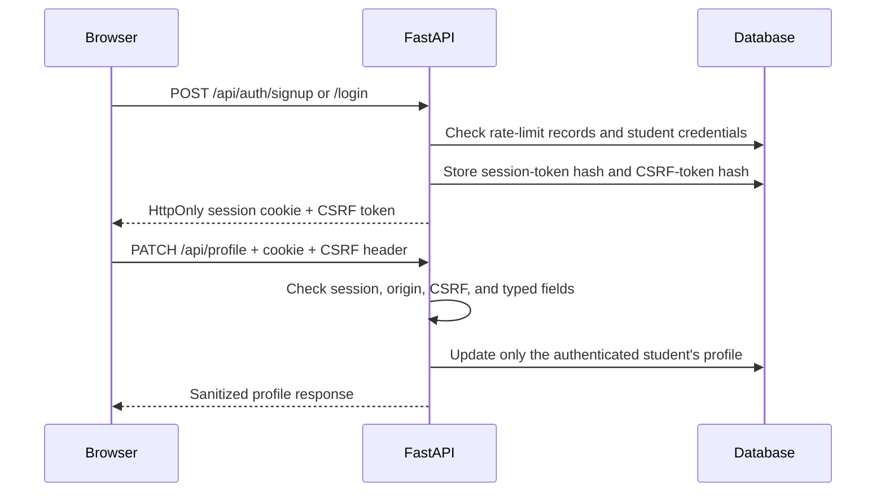
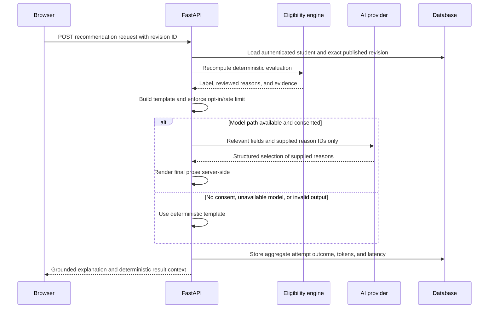
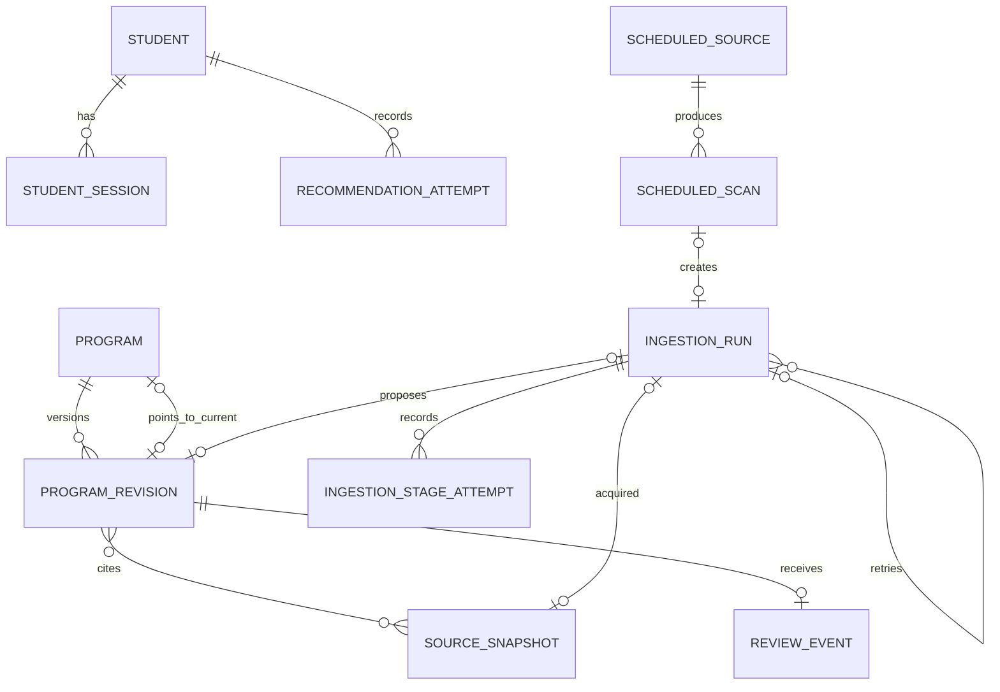
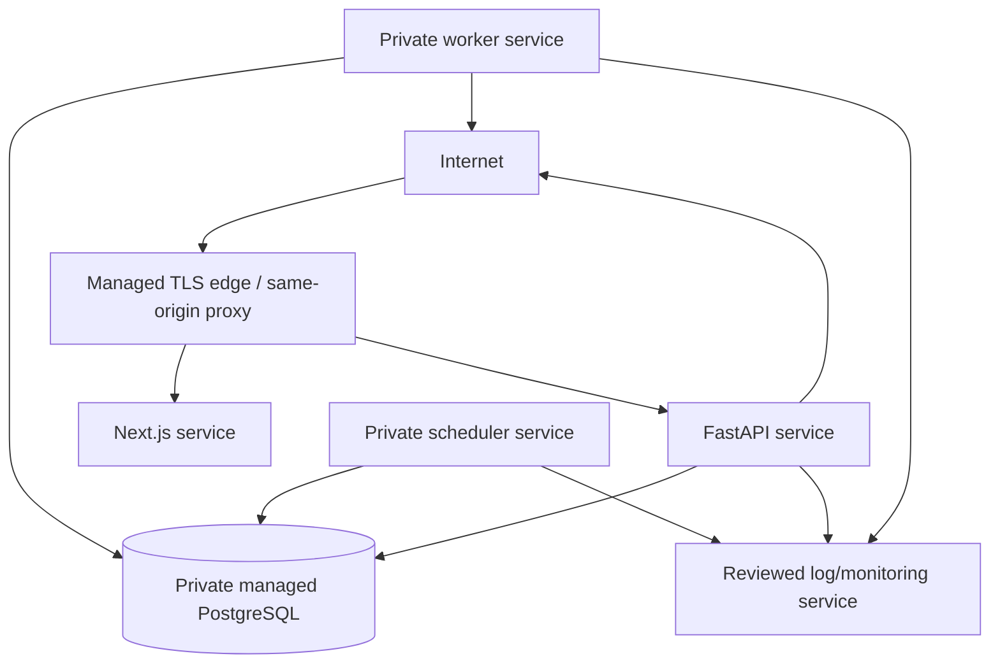

# Pathaid Architecture

## 0. Document control

| Field | Value |
|---|---|
| Product | Pathaid — Scholarships, Financial Aid, and Benefits Navigator |
| Status | In progress |
| Owner | Aidan Jiang |
| Architecture version | 0.1 |
| Last updated | 2026-10-24 |
| Implementation baseline | `feature/reviewed-launch-catalog` at `bae9ec7` |
| Related documents | [MVP](MVP.md), [PRD](PRD.md), [architecture diagrams](ARCHITECTURE_DIAGRAM.md), [plan](../plan.md), [features](../features/README.md), and [deployment guide](deployment.md) |

Statements marked **implemented** are supported by the implementation baseline above. **Pending** items describe the intended MVP architecture and must not be presented as deployed functionality.

## 1. Executive summary

Pathaid is a source-backed aid navigator for US college students. It stores a reusable student profile, evaluates that profile against reviewed program rules, and returns deterministic eligibility results, evidence, application checklists, and official links. A protected administrator workflow uses AI to propose catalog data from official sources, but a person must validate and publish every public revision.

The implemented backend is a modular Python monolith with three runtime processes:

- A FastAPI process serves student, catalog, evaluation, recommendation, administrator, and health endpoints.
- A Python worker claims durable ingestion stages from the relational database.
- A Python scheduler selects due administrator-approved sources and creates idempotent ingestion work.

All three processes use the same SQLAlchemy models and PostgreSQL database. Alembic owns schema changes. Gemini or OpenAI is an optional external dependency for requirement extraction and consent-gated recommendation assistance. Deterministic results and template explanations continue to work without model access.

The responsive Next.js frontend implements the student and administrator routes, including source scheduling, ingestion inspection, retained-source comparison, validation findings, editing, and publication controls. Automated desktop/mobile browser and accessibility checks pass locally. Controlled human source review, a public hosting provider, domain, TLS edge, external monitoring, and production backup schedule remain pending.

### 1.1 Architecture style

| Area | Decision | State |
|---|---|---|
| Application style | Modular monolith with separate API and worker processes | Implemented |
| API | REST-like JSON API using FastAPI and Pydantic | Implemented |
| Domain logic | Framework-independent eligibility and ranking modules | Implemented |
| Persistence | SQLAlchemy 2 ORM with Alembic migrations | Implemented |
| Production database | PostgreSQL 16 | Local Compose and CI implemented; hosted instance pending |
| Local fallback | SQLite through `DATABASE_URL` default | Implemented for direct local development |
| Background work | Database-backed state machine with leases; no message broker | Implemented |
| Scheduled discovery | Database-backed daily schedules, bounded one-hop discovery, and hash change detection | Implemented |
| AI integration | Configurable Gemini or OpenAI structured-output API behind extraction and recommendation adapters | Implemented; live quality measurements pending |
| Web client | Responsive Next.js student and administrator application | Implemented and browser-tested locally |
| Deployment | Docker image and Docker Compose topology | Implemented locally; public deployment pending |

### 1.2 Primary quality priorities

1. **Correctness and explainability:** eligibility labels come from validated rules and have requirement-level reasons.
2. **Publication integrity:** only an approved current revision is public.
3. **Privacy and access control:** profiles, sessions, sources, and drafts stay within their authorization boundaries.
4. **Recoverability:** ingestion progress survives worker restarts and abandoned leases expire.
5. **Maintainability:** HTTP handling, domain rules, persistence, AI adapters, and orchestration have explicit module boundaries.
6. **Low operating cost:** the MVP targets no more than $25 per month and avoids a separate queue service.

## 2. Goals, constraints, and non-goals

### 2.1 Architectural goals

- Support PRD FR-001 and FR-002 with server-side sessions, account isolation, optional profile fields, and recorded AI consent.
- Support FR-003 through FR-006 with immutable source snapshots, versioned publications, deterministic evaluation, stable ranking, and evidence-linked results.
- Support FR-007 through an optional model boundary that cannot change eligibility output or introduce unsupported claims.
- Support FR-008 through FR-010 with bounded source acquisition, schema-constrained extraction, durable stages, protected review, and atomic publication.
- Support FR-011 with migrations, CI, containers, readiness checks, privacy-safe telemetry, and documented recovery procedures.
- Support FR-012 with a same-origin Next.js client for student and administrator workflows.

### 2.2 Constraints and assumptions

- The MVP has one deployment-configured administrator; there is no admin registration or role hierarchy.
- The launch catalog contains 10–20 manually reviewed programs, so the architecture favors correctness over large-scale search infrastructure.
- Student profile fields remain optional. Missing information is a domain value, not a validation failure.
- Browser mutations use cookies and CSRF protection. The frontend proxies `/api` through the same origin.
- One worker is the default deployment. Leases protect correctness if more than one worker runs.
- The deployed data store is PostgreSQL. SQLite exists for convenient local development and is not the target hosted database.
- Current hosting prices and services must be evaluated when a provider is selected.

### 2.3 Non-goals

- Microservices, Kubernetes, Kafka, Redis, or a dedicated job broker.
- Vector search, embeddings, RAG, broad autonomous crawling, search-engine scraping, or PDF ingestion. Approved sources and bounded one-hop discovery are in scope.
- Model-generated eligibility decisions or autonomous publication.
- Provider accounts, student application submission, document storage, or checklist progress tracking.
- Multi-region failover or high-volume horizontal scaling for the portfolio MVP.

## 3. System context



### 3.1 Actors and external systems

| Actor or system | Responsibility | Data exchanged | Trust boundary |
|---|---|---|---|
| Student | Manages a private profile and evaluates published programs | Credentials, profile answers, consent, temporary answers | Browser to Pathaid |
| Administrator | Submits sources, reviews drafts, and records publication decisions | Deployment credential, source URL/text, edits, attestations | Browser to protected admin API |
| Official websites | Authoritative source and final application destination | Public webpage text; outbound student navigation | Pathaid to public internet |
| Configured AI provider | Proposes structured extraction and selects grounded explanation reasons | Retained source text for extraction; consented relevant profile facts for recommendations | Pathaid to third party |
| Hosting and log provider | Runs containers and retains configured operational output | Structured route/status/latency events | Application to infrastructure provider |

### 3.2 Ownership boundaries

**Inside Pathaid:** account/session management, profiles, catalog revision history, source snapshots, eligibility rules, ranking, evaluation responses, ingestion state, review decisions, model-call metadata, and operational aggregates.

**Outside Pathaid:** official program policy, current provider availability, award decisions, application submission, provider sites, configured AI service behavior, and the selected hosting platform.

Pathaid must never describe its application-eligibility result as an award decision. Official providers remain authoritative.

## 4. Container architecture

In this section, a container means a separately runnable application or datastore.

```mermaid
flowchart TB
    Browser[Student or admin browser]
    Edge[HTTPS edge and same-origin proxy\nPending]
    Frontend[Next.js frontend]
    API[FastAPI API]
    Worker[Python ingestion worker]
    Scheduler[Python daily scheduler]
    Migrate[Alembic migration job]
    DB[(PostgreSQL 16)]
    AI[Configured Gemini or OpenAI API]
    Web[Official public websites]

    Browser --> Edge
    Edge --> Frontend
    Edge -->|/api and /health| API
    Frontend -->|JSON| API
    Migrate -->|Upgrade schema before startup| DB
    API -->|SQLAlchemy / psycopg| DB
    Worker -->|SQLAlchemy / psycopg| DB
    Scheduler -->|Schedules and idempotent runs| DB
    Worker -->|Bounded HTTP(S)| Web
    Worker -->|HTTPS| AI
    API -->|HTTPS when opted in| AI
```

### 4.1 Container inventory

| Container | Responsibility | Technology | State | Scaling approach |
|---|---|---|---|---|
| Web frontend | Student and administrator flows; same-origin API access | Next.js 16.4.2, React 19, TypeScript | Implemented locally | One service for MVP |
| API | HTTP validation, authentication, authorization, catalog reads, evaluation, optional recommendations, review operations | Python 3.14, FastAPI, Pydantic, Uvicorn | Implemented | One instance initially; stateless except DB sessions |
| Worker | Acquisition, extraction, validation, and draft creation | Python 3.14 process | Implemented | One process by default; DB leases permit additional workers |
| Scheduler | Select due sources, coordinate scoped discovery, compare freshness, enqueue runs | Python 3.14 process | Implemented | One process by default; DB claims prevent duplicate windows |
| Migration job | Applies ordered schema versions before application startup | Alembic | Implemented | One-shot per release |
| Database | System of record and durable job coordination | PostgreSQL 16, SQLAlchemy, psycopg | Implemented locally and in CI | One private instance for MVP |

### 4.2 Communication paths

| Source → destination | Protocol | Authentication | Retry and consistency behavior |
|---|---|---|---|
| Browser → API | HTTPS JSON in production | Student or admin HttpOnly session cookie; CSRF token for mutations | Browser may retry reads; writes enforce state and uniqueness constraints |
| API/worker → database | SQL via SQLAlchemy and psycopg | Database service credential | Transaction boundaries protect account, publication, and stage changes |
| Scheduler → database | SQL via SQLAlchemy and psycopg | Database service credential | Atomic due-source claim and scheduled-window idempotency |
| Worker → official source | HTTP(S), public text content only | None in MVP | At most five redirects; a bounded acquisition attempt is retried by orchestration when classified transient |
| Worker → AI provider | HTTPS structured-output API | Server-side API key | Timeout and up to three orchestration stage attempts; invalid/refused/configuration results stop for review |
| API → AI provider | HTTPS structured-output API | Server-side API key | Failure returns the deterministic template explanation |

No browser communicates directly with PostgreSQL, the worker, or an AI provider. PostgreSQL and the worker have no host port in the Compose deployment.

## 5. Backend component design

### 5.1 Module inventory

| Module | Responsibility | Depends on |
|---|---|---|
| `app.main` | FastAPI assembly, student auth/profile routes, public catalog, evaluation, recommendation endpoint | Schemas, catalog, discovery, eligibility, recommendations, database |
| `app.admin_auth` | Single-admin login, session, CSRF, origin check, and rate limiting | Database models |
| `app.admin_api` | Ingestion submission, listing, detail, retry, and operations summary | Admin auth, orchestration, database |
| `app.admin_review` | Draft inspection/editing, replacement drafts, approval, rejection, publication | Validation, catalog models, admin auth |
| `app.profile_fields` | Canonical typed profile field registry and patch validation | Standard library |
| `app.eligibility` | Rule-tree validation and three-valued evaluation | Standard library only |
| `app.discovery` | Coverage matching and stable eligibility/availability ranking | Standard library and eligibility result types |
| `app.catalog` | Queries that expose current published revisions only | SQLAlchemy models |
| `app.catalog_schemas` | Public catalog response contracts | Pydantic |
| `app.evaluation_schemas` | Evaluation request and response contracts | Pydantic |
| `app.recommendations` | Template explanation, minimized model payload, provider adapters, output rendering | Evaluation schemas, provider SDKs |
| `app.recommendation_schemas` | Strict model and API contracts for recommendations | Pydantic |
| `app.source_acquisition` | URL validation, DNS/IP safety, bounded fetching, redirect validation, HTML normalization | Standard library networking |
| `app.source_service` | Acquisition entry point and immutable snapshot persistence | Acquisition, SQLAlchemy models |
| `app.extraction` | Structured-output extraction provider boundary and deterministic test stub | Provider SDKs, extraction schemas |
| `app.extraction_schemas` | Strict extracted-draft shape | Pydantic |
| `app.extraction_validation` | Exact-evidence, rule, URL, deadline, and coverage validation | Eligibility and extraction schemas |
| `app.orchestration` | Run creation, idempotency, leases, retries, and manual retry | SQLAlchemy models |
| `app.orchestration_stages` | Acquisition, extraction, validation, and draft-persistence stage transitions | Domain services and orchestration |
| `app.worker` | Poll loop and execution of one claimed stage | Orchestration and stage handlers |
| `app.scheduled_discovery` | Poll due approved sources and create idempotent scheduled runs | Scheduled-source service and database |
| Scheduled-source service | Registry, cadence, scope, robots policy, hash comparison, and candidate deduplication | Acquisition and orchestration |
| `app.models` | SQLAlchemy table and relationship definitions | Database base |
| `app.database` | Engine, session factory, declarative base, request dependency | SQLAlchemy |
| `app.health` | Liveness and migrated-database readiness | Database and SQLAlchemy inspection |
| `app.telemetry` | Privacy-reduced request metrics | FastAPI request metadata and logging |
| `app.quality_report` | Versioned offline benchmark reporting | Benchmark modules and datasets |

### 5.2 Dependency rules

- Route modules may call domain services and persistence helpers.
- `eligibility.py` contains no FastAPI, SQLAlchemy, network, or model dependency.
- `discovery.py` operates on in-memory records and does not query the database.
- AI adapters consume explicit schemas and cannot publish revisions.
- Only catalog query helpers and protected admin operations decide which revisions are visible.
- Orchestration persists a completed stage before the next claim; worker process memory is never the source of truth.
- Source acquisition and model providers are replaceable in tests through injected protocols or factories.

### 5.3 Repository layout

```text
Pathaid/
├── backend/
│   ├── app/                 # API, domain modules, worker, persistence
│   ├── data/                # Versioned synthetic benchmark datasets
│   ├── migrations/          # Alembic environment and ordered revisions
│   ├── tests/               # Unit and integration tests
│   ├── Dockerfile           # Shared API/worker production image
│   └── requirements*.txt    # Runtime and development dependencies
├── docs/                    # Product, architecture, design, deployment docs
├── features/                # Feature-level behavior specifications
├── frontend/                # Next.js student and administrator application
├── .github/workflows/       # Backend, frontend, migration, and container CI
├── compose.yaml             # Local frontend, API, worker, scheduler, migration, and database topology
└── plan.md                  # Delivery plan and status
```

## 6. Runtime behavior

### 6.1 Student authentication and profile



- Passwords use `hashlib.scrypt` with a unique random salt.
- Raw session and CSRF tokens are never stored; SHA-256 digests are stored.
- Student sessions expire after seven days.
- Authentication attempts are limited to ten per direct peer address in fifteen minutes.
- Profile patch and delete plus logout require the session, CSRF header, and allowed-origin check.
- Deleting the profile endpoint deletes the account and its dependent session data.

### 6.2 Discovery and eligibility evaluation

1. `POST /api/evaluate` authenticates the student.
2. Saved profile values are combined with validated temporary answers. Temporary answers are not persisted.
3. The catalog query returns current published revisions only, optionally constrained by categories.
4. Coverage matching determines whether a program covers the student's known institution, state, or national context.
5. `evaluate_eligibility` validates and evaluates the exact revision rule tree using `true`, `false`, and `unknown` values.
6. The response attaches criterion-level reasons and resolves evidence only against source snapshots linked to that same revision.
7. Ranking sorts deterministically by coverage/relevance, eligibility, availability (`open`, `unknown`, `closed`), verification recency, and stable identifiers.
8. The API returns verification states, missing questions, unresolved conditions, checklist, selection factors, official URLs, sources, and a deterministic template explanation.

The model is not called during this flow.

### 6.3 Optional recommendation explanation



The provider selects among facts already supplied by Pathaid. Server code renders the final explanation, preventing the model from changing labels or inventing amounts, deadlines, or requirements. The default limit is ten model attempts per student per hour.

### 6.4 Ingestion and publication

```mermaid
sequenceDiagram
    participant Admin as Administrator
    participant API as Admin API
    participant DB as Database
    participant W as Worker
    participant Site as Official website
    participant AI as AI provider

    Admin->>API: Submit source + idempotency key
    API->>DB: Create queued ingestion run
    W->>DB: Atomically claim due stage with lease
    W->>Site: Acquire bounded public text
    W->>DB: Persist immutable source snapshot and stage outcome
    W->>DB: Claim extraction stage
    W->>AI: Request strict structured draft
    AI-->>W: Draft + usage metadata
    W->>DB: Persist extracted draft and stage outcome
    W->>DB: Claim validation stage
    W->>W: Validate rules, URLs, coverage, and exact evidence
    W->>DB: Create unpublished revision; await review
    Admin->>API: Inspect/edit and attest to accuracy/completeness
    API->>DB: Revalidate and atomically approve/publish or reject
```

#### Acquisition controls

- Supports public HTTP(S) webpages and administrator-pasted text.
- Rejects credentials in URLs, local hostnames, non-public IP addresses, unsafe schemes, and HTTPS-to-HTTP redirects.
- Resolves and pins public destination addresses, validating every redirect to reduce SSRF and DNS-rebinding risk.
- Defaults to five redirects, ten seconds total, 2 MB response content, and 500,000 normalized characters.
- Accepts text content and normalizes visible HTML text. PDF ingestion is outside MVP scope.
- Stores a SHA-256 content hash and immutable normalized source text.

#### Job semantics

- The database is both the queue and the job-state store; there is no external broker.
- A run advances through `queued`, `acquiring`, `extracting`, `validating`, then `awaiting_review`.
- `published`, `rejected`, and `failed` are terminal states.
- A claim writes a random lease token, worker owner, and expiration. Stage writes require that valid token.
- A successful stage commits before another claim, so completed work is reused after restart.
- Retryable stage failures use bounded exponential delays. The default maximum is three attempts and cannot be configured higher.
- Unsafe input, invalid drafts, refusals, and missing configuration stop rather than silently publishing.
- An idempotency key plus request fingerprint prevents accidental duplicate submission with different input.

### 6.5 Scheduled discovery and refresh

```mermaid
sequenceDiagram
    participant S as Scheduler
    participant D as Database
    participant W as Worker
    participant P as Approved source
    participant A as Administrator

    S->>D: Atomically claim sources due this morning
    S->>D: Create one idempotent scan/run per source window
    W->>P: Fetch within robots, host, path, delay, and size limits
    W->>D: Compare normalized content hash
    alt Unchanged
        W->>D: Record successful freshness check; no model call
    else Changed or new scoped candidate
        W->>D: Persist snapshot and continue extraction/validation
        W->>D: Create private draft or candidate review item
        A->>D: Review and approve or reject material content
    end
```

- The registry distinguishes known `program_page` targets from `discovery_page` indexes.
- Only administrators manage registry entries. Public requests cannot add crawler targets.
- Discovery is limited to canonical HTTP(S) links within an approved host/path scope, one hop, and a fixed link budget.
- Scans respect robots directives, source terms, per-host cycle limits, acquisition limits, and bounded retry policy.
- A deterministic key derived from source and scheduled window prevents duplicate work across overlapping scheduler processes.
- One source failure does not stop the daily batch. Repeated failures back off and become visible to administrators.
- Fetch failure or page removal never closes, removes, or rewrites public content automatically.
- New scholarships and material changes require human approval. Only unchanged-source freshness is updated automatically.
- Student evaluations read current revisions at request time, so publication affects future evaluations without a background reevaluation job.

#### Publication invariants

- Extraction creates a draft only.
- Draft edits rerun deterministic validation, including exact evidence checks.
- Approval requires source-accuracy attestation and an explicit completeness decision.
- A published revision retains one append-only approval decision.
- Publication changes the program's current revision pointer in the same transaction.
- Editing published content creates a replacement draft; it does not rewrite history.
- Public queries follow the current pointer and require `published` status, so drafts, rejected revisions, superseded revisions, and broken pointers remain private.

## 7. Data architecture

### 7.1 Core entity model



Supporting tables record student and administrator authentication attempts and administrator sessions.

### 7.2 Data ownership and sensitivity

| Dataset | Source of truth | Sensitivity | Notes |
|---|---|---|---|
| Student account/profile | PostgreSQL `students` | High | Email, password hash, optional profile JSON, AI opt-in |
| Student/admin sessions | PostgreSQL session tables | High | Token hashes, CSRF hashes, expiry; raw tokens stay in browser cookies |
| Authentication attempts | PostgreSQL attempt tables | Moderate | One-way digest of direct peer address and timestamp |
| Program and revision | PostgreSQL catalog tables | Public after approval; private while draft | Published revisions are historical records |
| Source snapshot | PostgreSQL `source_snapshots` | Operationally sensitive | Retained official source body, URL, hash, acquisition metadata |
| Ingestion input/run | PostgreSQL ingestion tables | Operationally sensitive | May contain pasted source text, errors, model metadata, leases |
| Scheduled source/scan | PostgreSQL tables | Operationally sensitive | URL, approved scope, cadence, due time, hash, outcome, and failure history |
| Review event | PostgreSQL `review_events` | Audit data | Reviewer identity, decision, notes, time |
| Recommendation attempt | PostgreSQL | Moderate aggregate data | Outcome, token counts, latency; no prompt or generated prose |
| Benchmark datasets | Version-controlled JSON | Synthetic | No student records or live model output |

### 7.3 Schema conventions

- Application IDs are string UUIDs generated in Python.
- Timestamps use timezone-aware SQLAlchemy columns and UTC-aware application comparisons. SQLite development compatibility converts naive values to UTC where required.
- Enumerated state values are protected with database check constraints.
- Foreign keys define delete behavior; account-owned sessions cascade with the student.
- JSON columns hold typed profile values, coverage, rule trees, checklists, selection factors, findings, and extracted drafts.
- Alembic revisions `0001` through `0009` are the authoritative ordered schema history for the implementation baseline.
- CI requires exactly one migration head, upgrades a fresh PostgreSQL database, and runs `alembic check` against SQLAlchemy metadata.
- There is no general soft-delete mechanism. Catalog history is preserved through immutable revisions and current-pointer changes.
- No cache is implemented. Reads use the database directly, providing transactionally current publication state.

### 7.4 Backup and retention

The deployment guide documents PostgreSQL custom-format backup and restore commands. Backups include credentials, profiles, source text, and review history, so they require encryption and restricted access. A restore rehearsal and production retention schedule are pending and are release gates. Concrete RPO and RTO values have not been approved and must not be invented.

## 8. API architecture

### 8.1 Conventions

- FastAPI exposes JSON routes and generates OpenAPI documentation from Pydantic schemas.
- The current API uses the `/api` prefix but has no numeric version prefix. Breaking changes require coordinated frontend/backend release until a version policy is introduced.
- Request models reject unexpected fields where security or contract clarity requires it.
- A custom validation handler returns affected field names without echoing rejected credentials or profile values.
- Public catalog responses omit retained source bodies.
- The implemented API does not enable broad CORS. Production should use a same-origin frontend proxy.
- No general pagination contract is implemented. The MVP catalog and administrator workload are intentionally small.

### 8.2 Endpoint inventory

| Area | Method and path | Access | Purpose |
|---|---|---|---|
| Operations | `GET /health/live` | Public | Process liveness |
| Operations | `GET /health/ready` | Public | Database access, required tables, and migration version |
| Profile metadata | `GET /api/profile-fields` | Public | Supported profile questions and types |
| Catalog | `GET /api/programs` | Public | Current published programs with optional category filtering |
| Catalog | `GET /api/programs/{program_id}` | Public | Current published detail and source metadata |
| Student auth | `POST /api/auth/signup` | Public, rate limited | Create student and session |
| Student auth | `POST /api/auth/login` | Public, rate limited | Authenticate and create session |
| Student auth | `GET /api/auth/session` | Student | Refresh client CSRF context |
| Student auth | `POST /api/auth/logout` | Student + CSRF | Revoke current session |
| Profile | `GET /api/profile` | Student | Read own profile |
| Profile | `PATCH /api/profile` | Student + CSRF | Update own fields and consent |
| Profile | `DELETE /api/profile` | Student + CSRF | Delete own account |
| Evaluation | `POST /api/evaluate` | Student | Evaluate and rank published candidates |
| Recommendation | `POST /api/programs/{program_id}/recommendation-explanation` | Student | Return template or consent-gated grounded explanation |
| Admin auth | `POST /api/admin/auth/login` | Public, rate limited | Create administrator session from deployment credential |
| Admin auth | `GET /api/admin/auth/session` | Admin | Refresh administrator CSRF context |
| Admin auth | `POST /api/admin/auth/logout` | Admin + CSRF | Revoke administrator session |
| Ingestion | `POST /api/admin/ingestion-runs` | Admin + CSRF | Submit idempotent ingestion run |
| Ingestion | `GET /api/admin/ingestion-runs` | Admin | List run summaries |
| Ingestion | `GET /api/admin/ingestion-runs/{run_id}` | Admin | Inspect source, stages, errors, and draft link |
| Ingestion | `POST /api/admin/ingestion-runs/{run_id}/retry` | Admin + CSRF | Create manual retry run |
| Scheduled sources | `GET/POST /api/admin/scheduled-sources` | Admin; CSRF for create | List or register approved scan targets |
| Scheduled sources | `PATCH /api/admin/scheduled-sources/{id}` | Admin + CSRF | Edit cadence/scope or enable/pause |
| Scheduled scans | `POST /api/admin/scheduled-sources/{id}/scan` | Admin + CSRF | Mark a source due for the scheduler |
| Scheduled scans | `GET /api/admin/scheduled-scans` | Admin | Inspect freshness, changes, candidates, and failures |
| Candidates | `GET /api/admin/discovered-candidates` | Admin | Inspect private links found within approved discovery scope |
| Review | `GET /api/admin/revisions/{revision_id}` | Admin | Inspect draft and evidence |
| Review | `PATCH /api/admin/revisions/{revision_id}` | Admin + CSRF | Edit and revalidate draft |
| Review | `GET /api/admin/programs/{program_id}/revisions` | Admin | Review revision history |
| Review | `POST /api/admin/programs/{program_id}/drafts` | Admin + CSRF | Copy a revision into a replacement draft |
| Review | `POST /api/admin/revisions/{revision_id}/approve` | Admin + CSRF | Attest, approve, and publish |
| Review | `POST /api/admin/revisions/{revision_id}/reject` | Admin + CSRF | Record rejection |
| Operations | `GET /api/admin/operations/summary` | Admin | Aggregate failures, recommendation performance, and source freshness |

## 9. Security architecture

### 9.1 Authentication and authorization

Student and administrator identities use separate session tables and separate HttpOnly cookies. Student sessions last seven days; administrator sessions last four hours. Raw session tokens are random and only returned as cookies. Server-side database records contain token digests.

The administrator identity is configured through `PATHAID_ADMIN_EMAIL` and `PATHAID_ADMIN_PASSWORD_HASH`. There is no stored admin account or registration route. Changing deployment credentials does not by itself revoke existing database sessions, so credential rotation procedures must revoke those sessions.

| Action | Anonymous | Student | Administrator |
|---|---:|---:|---:|
| Read published catalog/profile field metadata | Yes | Yes | Yes |
| Read or change own profile | No | Own account only | No implicit access |
| Evaluate programs | No | Yes | No implicit access |
| Request recommendation assistance | No | Yes, subject to consent for model use | No implicit access |
| Inspect source bodies and drafts | No | No | Yes |
| Submit/retry ingestion | No | No | Yes + CSRF |
| Edit, approve, reject, or publish revision | No | No | Yes + CSRF |

### 9.2 Threats and controls

| Threat | Implemented controls | Remaining deployment work |
|---|---|---|
| Credential theft | Scrypt password hashes, HttpOnly cookies, token digests, safe validation responses | TLS, secure-cookie flag, secret store, rotation procedure |
| CSRF | Separate random CSRF token, hash comparison, SameSite=Lax, origin/fetch-site checks | Exact HTTPS public origin and same-origin proxy |
| Cross-account access | Session-derived student ID; profile routes do not accept an account ID | End-to-end browser verification |
| Brute-force login | Shared database attempt records keyed by hashed direct peer address | Trusted proxy/client-IP policy before public exposure |
| Draft or source disclosure | Separate admin authentication; public queries expose published records and source metadata only | Hosting/log access review |
| Unreviewed publication | Draft states, deterministic validation, human attestations, unique review decision, transactional current pointer | Operational access controls |
| SQL injection | SQLAlchemy expressions and bound parameters | Dependency and security maintenance |
| SSRF/DNS rebinding | Scheme/host/IP validation, public-address resolution and pinning, redirect revalidation, TLS hostname verification | Egress rules where hosting supports them |
| Oversized or slow sources | Total timeout, content and normalized-text limits, redirect cap | Platform resource limits |
| Abusive or uncontrolled crawling | Administrator-only registry, robots policy, allowed host/path, one-hop/link budget, one source per host per cycle | Verify controls with approved external sources |
| AI hallucination | Strict extraction schema, exact-evidence validation, human review; recommendation reason selection and server rendering | Live model evaluation before claims about quality |
| Sensitive telemetry | Route templates instead of raw paths; no body, header, cookie, prompt, explanation, or profile logging | Review platform request capture and retention |
| Duplicate/concurrent work | Idempotency fingerprints, transactional leases, lease-token fencing | PostgreSQL concurrency verification in host environment |

### 9.3 Secrets and transport

Local Compose reads environment variables from an uncommitted root `.env`. Production secrets must use the selected host's secret store. Required secrets include PostgreSQL credentials, the encoded administrator password hash, and optionally the selected AI provider API key.

The container does not terminate TLS. A managed edge or reverse proxy must terminate HTTPS, route the frontend and `/api` under the same origin, and set `PATHAID_SECURE_COOKIES=true`. Database and worker network access must remain private.

## 10. AI architecture and responsibility boundary

### 10.1 Requirement extraction

The worker sends one retained source snapshot to the configured `GeminiExtractionAdapter` or `OpenAIExtractionAdapter`, which requests the strict `ExtractedProgramDraft` schema. The adapter records model, prompt version, schema version, available provider request metadata, and token usage. It does not receive student data and cannot write a published revision.

The deterministic validator then checks:

- Allowed rule fields, operators, operand types, tree depth, and node count.
- Snapshot identity and exact occurrence of evidence excerpts.
- Coverage and application URL consistency.
- Deadline and timezone representation.
- Unsupported or ambiguous conditions.

Only the subsequent administrator workflow can publish the resulting draft.

### 10.2 Recommendation assistance

Recommendation assistance runs only after the student's `ai_opt_in` is true. Its payload includes only profile fields referenced by the evaluated rule and supplied reviewed reasons. It excludes email, credentials, session values, and unrelated profile values.

The model returns a structured selection of supplied reason identifiers rather than free-form product facts. Pathaid renders the prose. Any missing key, timeout, refusal, provider failure, rate limit, or invalid selection falls back to the template explanation.

### 10.3 Model configuration and evaluation

Extraction and recommendation select `openai` or `gemini` independently through environment variables. Each provider has a default model and supports an explicit model override. The two tasks have separate timeouts and output-token limits. The eligibility benchmark is deterministic and currently reports 100/100 expected cases. The extraction dataset and metric harness are implemented, but live extraction accuracy is unmeasured. No production model-quality claim should be made until a saved, versioned predictions artifact is evaluated.

## 11. Deployment architecture

### 11.1 Implemented local topology

The implemented `compose.yaml` defines:

1. `database`: PostgreSQL 16 Alpine with a persistent named volume and health check.
2. `migrate`: a one-shot backend image running `alembic upgrade head` after the database becomes healthy.
3. `api`: the backend image running Uvicorn after migration succeeds; host binding is limited to `127.0.0.1:8000`.
4. `worker`: the same backend image running `python -m app.worker` after migration succeeds.

The `scheduler` service uses the same backend image, starts after migration, and runs `python -m app.scheduled_discovery`.

The backend image runs as a fixed unprivileged `pathaid` user. It disables Python bytecode writes and Uvicorn access logs. Docker restart policy is `unless-stopped` for the database, API, and worker.

### 11.2 Health model

- `/health/live` proves the API process can serve a request.
- `/health/ready` runs a database query, checks required tables, and requires Alembic revision `0009_recommendation_latency`.
- Readiness returns a generic 503 reason for unavailable or unmigrated databases without leaking connection details.

This exact expected-revision check means every schema release must update the health module alongside its new Alembic head.

### 11.3 Continuous integration

GitHub Actions runs for backend changes on pushes and pull requests. It:

1. Starts PostgreSQL 16.
2. Installs Python 3.14 development dependencies.
3. Requires exactly one Alembic migration head.
4. Applies all migrations to a fresh database.
5. Runs `alembic check` to detect model/schema drift.
6. Runs the pytest suite without paid model calls.
7. Generates offline quality measurements.
8. Builds the production backend image.
9. Validates the Compose configuration.

CI does not deploy the application. Continuous deployment is pending provider selection.

### 11.4 Proposed hosted topology



Provider, region, service sizes, domain, deployment trigger, log retention, database backup frequency, RPO, and RTO remain open decisions. They require current price validation against the $25 monthly target.

## 12. Observability and operations

- API middleware logs one JSON `api_request` event with HTTP method, matched route template, response status, and latency.
- Raw paths are not used as a fallback because they can contain identifiers.
- Uvicorn access logging is disabled in the production image.
- Ingestion runs and stage attempts persist state, safe error codes/messages, attempt count, timing, and latency.
- Scheduler telemetry includes scan outcome, change detection, overdue count, candidate count, review backlog, and per-host throttling without source bodies.
- Recommendation attempts persist aggregate outcome, model metadata, token counts, and latency without prompts or generated explanations.
- The admin operations summary aggregates recent ingestion failures, recommendation outcomes/latency, and oldest publication verification time.
- External uptime checks, alerts, dashboards, and log-retention rules are pending deployment.

Operational logs must never include request/response bodies, cookies, authorization headers, profile values, pasted sources, retained source bodies, prompts, or generated explanations.

## 13. Performance and scaling

No production load baseline exists yet. The MVP architecture is sized for a small portfolio demonstration and 10–20 published programs.

- Evaluation executes synchronously because the catalog and rule trees are bounded; rule trees allow at most eight levels and 200 nodes.
- Source acquisition and extraction run in the worker so they do not block API requests.
- Recommendation assistance is synchronous but bounded by its configured timeout and always has a template fallback.
- Database indexes cover session lookup, catalog publication/state, run state/scheduling/leases, and common foreign keys.
- A second worker can claim different work through database leases, but hosted PostgreSQL concurrency must be verified before increasing worker count.
- If observed demand outgrows direct catalog scans or database polling, measurements should drive pagination, caching, or a queue. Those additions are not justified for MVP scale today.

## 14. Failure handling and recovery

| Failure | Behavior | Recovery |
|---|---|---|
| Database unavailable | Readiness fails; database-backed routes fail safely | Restore connectivity; API/worker restart policies apply |
| Migration missing | API readiness returns 503 | Run Alembic migration job before traffic |
| Worker stops during stage | Lease eventually expires; committed prior stages remain | Another worker claims the due stage |
| Official source timeout/transient response | Stage records safe error and schedules bounded retry | Automatic retry up to configured maximum |
| Unsafe URL or invalid content | Run stops with non-retryable failure | Administrator corrects input and creates manual retry |
| Missing selected provider key during extraction | Explicit configuration failure | Configure the matching key and use protected manual retry |
| Model refusal/invalid extraction | Run fails without draft publication | Administrator reviews and retries after corrective action |
| Recommendation model failure | Template explanation returned | No user-blocking recovery required |
| Invalid draft edit | Validation findings returned; draft remains private | Administrator corrects draft/evidence |
| Backup restoration needed | Follow documented PostgreSQL restore procedure | Restore, migrate, restart, and check readiness |

## 15. Verification strategy

| Architectural property | Evidence |
|---|---|
| Domain determinism | Eligibility, discovery, and 100-case benchmark tests |
| Account isolation and session safety | Student/admin auth and API tests |
| Published-only catalog | Catalog model, query, and API tests |
| Evidence fidelity | Extraction validation, source persistence, and result tests |
| SSRF and acquisition bounds | Source validation and web acquisition tests with fake transports/resolvers |
| Lease and retry correctness | Orchestration claim, stage, validation, and worker tests |
| Scheduled refresh safety | Fake-clock tests cover overlapping claims, hashes, robots/scope, throttling, link limits, and failure isolation |
| Human publication authority | Admin review/publication tests and database constraints |
| AI fallback and minimization | Recommendation adapter and service tests |
| Migration compatibility | PostgreSQL CI migration plus `alembic check` |
| Container reproducibility | Image build and Compose validation in CI; local health verification |
| Frontend accessibility/usability | Desktop/mobile Playwright and automated WCAG checks pass; five observed sessions pending |
| Hosted recovery and reliability | Pending deployment, monitoring window, and restore rehearsal |

## 16. Architecture decisions

| ID | Decision | Reason | Consequence |
|---|---|---|---|
| ADR-001 | Use a modular monolith | MVP modules share transactions and one small team owns the system | Deploy API and worker from one codebase; preserve module boundaries |
| ADR-002 | Keep eligibility independent of web and persistence frameworks | Rules must be reproducible and easy to benchmark | API converts database records into pure inputs |
| ADR-003 | Use three-valued logic | Missing or unsupported data must not become a false pass/fail | UI must explain unresolved results and follow-up questions |
| ADR-004 | Version catalog content and point to one current revision | Public facts require history and auditability | Edits create drafts; publication changes a pointer atomically |
| ADR-005 | Retain immutable source snapshots and exact evidence | Reviewers and students need traceable claims | Source bodies are sensitive operational data and increase storage |
| ADR-006 | Use the relational database as the job queue | Keeps MVP operations and cost small while preserving durable state | Polling and lease logic live in the application; no broker semantics |
| ADR-007 | Separate API and worker processes | Slow external acquisition/model work must not block web requests | Both processes require compatible code and schema versions |
| ADR-008 | Put AI behind strict adapters and deterministic validation | Model output is untrusted and cannot own decisions | Human review and fallback paths remain required |
| ADR-009 | Use server-side opaque sessions and CSRF tokens | Supports browser flows without exposing bearer tokens to JavaScript | Requires shared session storage and same-origin deployment discipline |
| ADR-010 | Use PostgreSQL for deployed environments and Alembic for schema history | Publication and leases need relational constraints and transactions | Migration must complete before application readiness |
| ADR-011 | Implement the approved responsive frontend as one same-origin Next.js service | Keeps student and administrator flows aligned with the API security model | Browser checks run against desktop and mobile layouts |
| ADR-012 | Schedule only approved sources and bounded one-hop discovery | Automates scholarship collection without an uncontrolled crawler | Administrators seed source scopes and review candidates |
| ADR-013 | Hash normalized content before extraction | Most daily scans should not spend model tokens or create noisy drafts | A successful unchanged check updates freshness only |
| ADR-014 | Keep human approval for material changes | Deadlines and eligibility errors can directly mislead students | Daily collection is automatic; publication still has a review queue |

## 17. Known limitations and risks

- The current working copy may not contain the implementation baseline unless the latest feature work is merged or checked out; architecture changes must be compared against the baseline named in document control.
- No public deployment has demonstrated the 99% limited-demo reliability target.
- Backup restoration is documented but has not been verified for a hosted database.
- Direct peer-address rate limiting needs an explicit trusted-proxy design before a public reverse proxy is used.
- There is no password reset, email verification, MFA, or administrator role separation in MVP scope.
- Public API pagination and general rate limiting are not implemented.
- The strict readiness check is coupled to a single expected migration revision and requires an intentional code update with each schema migration.
- Retained source text and pasted source input require a formal production retention policy.
- Live extraction quality, cost, and latency are not measured.
- Automated frontend accessibility and browser checks pass; five observed student usability sessions remain pending.
- The launch catalog and its ongoing freshness cadence remain pending.
- Scheduled-source tables, APIs, scheduler process, robots policy, bounded discovery, and administration UI are implemented. A controlled local official-source cycle verified changed-content review and unchanged-content model skipping; hosted verification remains pending.

## 18. Open architecture decisions

1. Select a hosting provider and region using current pricing while keeping the expected monthly cost at or below $25.
2. Select the hosted Node service and same-origin edge topology for the implemented Next.js standalone server.
3. Select the same-origin routing/TLS approach and document trusted proxy behavior.
4. Define production backup frequency, retention, RPO, RTO, and restore-test cadence.
5. Select external uptime monitoring and structured log retention settings.
6. Define student data and retained source deletion/retention periods.
7. Decide how migrations are coordinated with traffic when more than one API instance is introduced.
8. Establish an API compatibility/versioning policy before external clients exist.
9. Choose the production morning time, default cadence, scheduler cycle interval, and discovery link budget.
10. Define measurable evidence required before considering any future automatic publication of material content.

