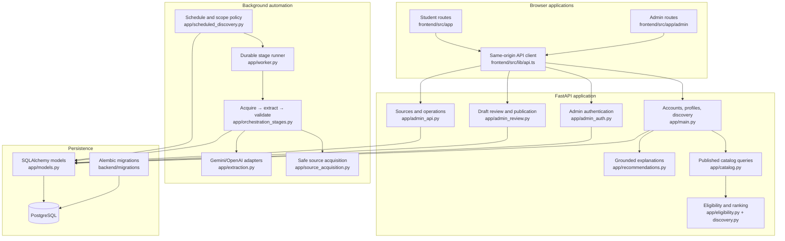
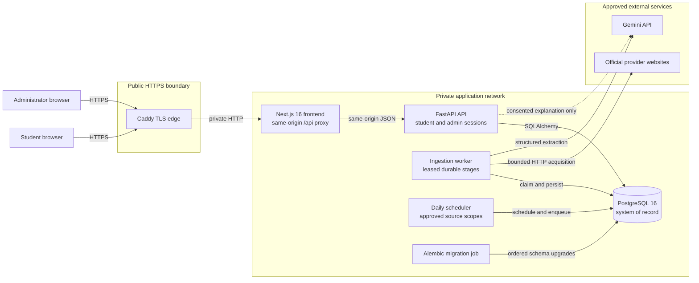
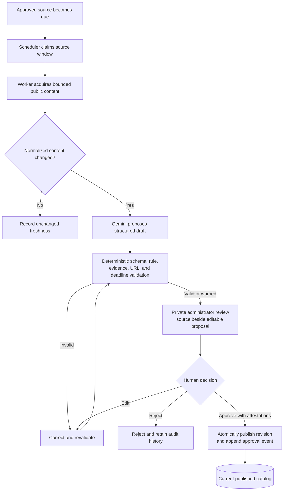
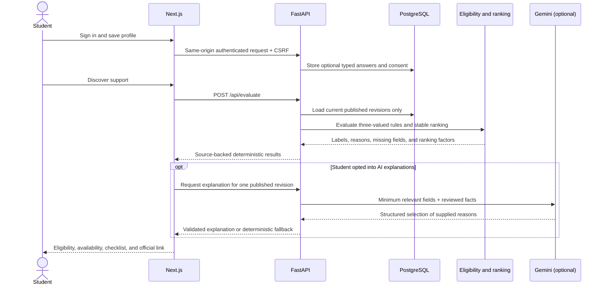

# Pathaid architecture diagrams

Last verified against `feature/reviewed-launch-catalog` on 2026-10-25. These
diagrams describe the implemented application and the prepared single-server
hosted topology. Public provisioning, human catalog approval, and hosted
verification remain release gates.

## Component and code map

The API process handles HTTP requests only. Scheduled acquisition and model
extraction run in separate processes, with PostgreSQL coordinating work and
preserving progress across restarts.

## Runtime and trust boundaries

Security boundaries:

- Caddy is the only public container in the prepared production overlay.
- PostgreSQL, the API, worker, scheduler, and migration job have no public
  production port.
- Student and administrator sessions use separate opaque HttpOnly cookies and
  CSRF tokens.
- Forwarded client addresses affect authentication throttling only when the
  socket peer belongs to `PATHAID_TRUSTED_PROXY_CIDRS`.
- Gemini never receives credentials or identity data and has no publication
  authority.

## Automated acquisition and human publication

The scheduler, worker, and model stop before publication. Only an authenticated
administrator can attest to source accuracy and publish a valid revision.

## Student matching and explanations

Eligibility, application availability, and award selection remain separate.
The model cannot change candidates, labels, ranking, deadlines, or amounts.

## Deployment units

| Unit | Implementation | Public exposure | Durable state |
|---|---|---|---|
| TLS edge | Caddy 2.11.4 | Ports 80/443 | Certificate volumes |
| Web | Next.js 16.4.2 standalone server | Through Caddy | None |
| API | FastAPI on Python 3.14 | Through Next.js `/api` proxy | PostgreSQL |
| Worker | Python ingestion process | None | PostgreSQL stages and leases |
| Scheduler | Python scheduling process | None | PostgreSQL schedules and scans |
| Migration | Alembic one-shot job | None | PostgreSQL schema history |
| Database | PostgreSQL 16 | None | Named volume and encrypted backup |

See [Architecture](ARCHITECTURE.md) for component details and
[Deployment](deployment.md) for configuration, migrations, backup, and the
prepared production Compose overlay.
