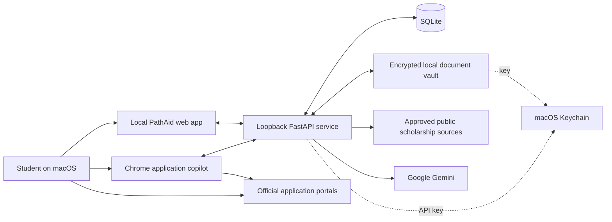
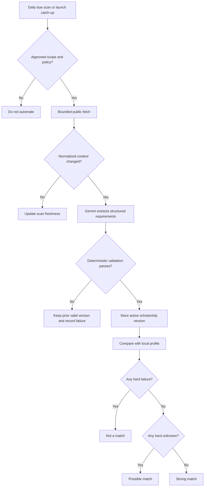
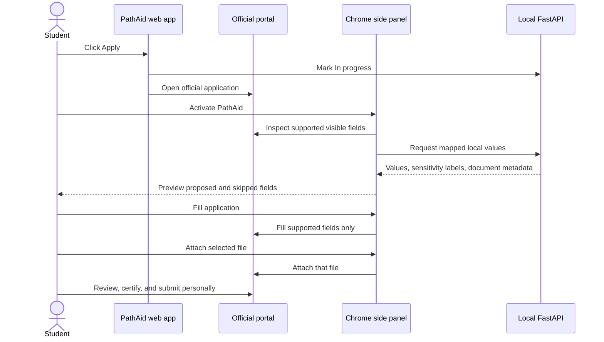
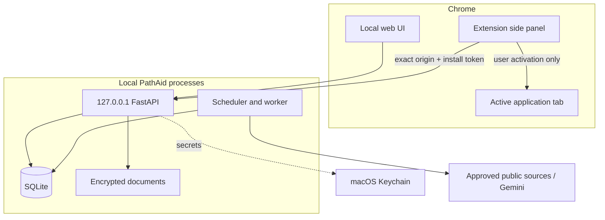

# PathAid architecture diagrams

These diagrams describe the approved local-first target, not every component in
the current legacy implementation.

## System context



## Discovery and matching



## Lead verification

```mermaid
sequenceDiagram
    actor U as User
    participant P as PathAid
    participant L as Lead listing
    participant S as Official sponsor

    U->>P: Save individual lead URL/title
    P->>L: Resolve sponsor/application reference
    P->>S: Acquire current official page
    alt official evidence is valid
        S-->>P: Current rules and application URL
        P-->>U: Show verified scholarship match
    else absent, stale, or unverifiable
        P-->>U: Keep lead history; hide from current matches
    end
```

## Application copilot



## Local security boundaries



## Target data ownership

| Data | Location | Sent externally? |
| --- | --- | --- |
| Student profile and match results | SQLite | No for eligibility |
| Public scholarship source text | Snapshots/SQLite | Yes, to Gemini extraction |
| Gemini key and document key | macOS Keychain | Gemini key only to Gemini |
| Résumé/transcript | Encrypted local vault | Only to user-selected portal attachment |
| Essays | SQLite/encrypted backup | Optional Gemini analysis when allowed |
| Portal credentials/cookies | Browser only | Never stored by PathAid |
